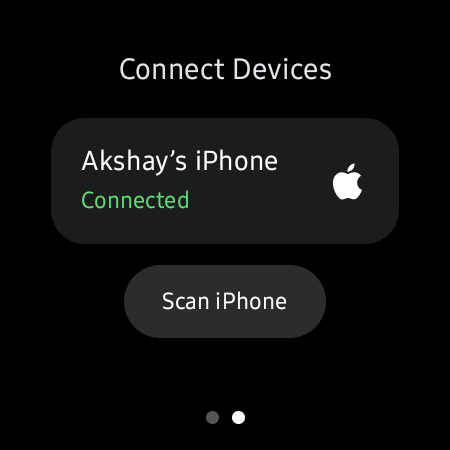

# WearSync — Connect Any Galaxy Watch or Pixel Watch to iPhone

Want to **connect your Samsung Galaxy Watch or Google Pixel Watch to an iPhone** for notifications? **WearSync** mirrors your iPhone notifications straight to **any Wear OS 3.0+ smartwatch** directly over Bluetooth — **no jailbreak and no iPhone companion app required**.

Works with **Samsung Galaxy Watch (4, 5, 6, 7, Ultra)**, **Google Pixel Watch (1, 2, 3)**, **OnePlus Watch**, **TicWatch**, and other Wear OS smartwatches running Wear OS 3.0 or newer.

---

## Screenshots

| Active Device | Connect Devices |
| :---: | :---: |
|  |  |

---

## Features

- **Use Wear OS with iPhone (No Extra iPhone App):** Connects directly from your watch to your iPhone over Bluetooth — nothing to install on iOS.
- **iPhone Notifications on Galaxy Watch & Pixel Watch:** Get WhatsApp, Messages, Phone calls, Gmail, Instagram, Slack, and other iOS alerts right on your wrist.
- **Shows Your Real iPhone Name:** Displays your actual iPhone name (like *Alex’s iPhone*) instead of a generic label.
- **Instant Popups & Clean Notification Drawer:** New alerts wake your watch screen with a full-screen popup card while keeping your notification drawer tidy with one active card at a time so alerts don’t get stacked or silenced.
- **Recognizable App Icons:** Displays familiar circular icons for WhatsApp, Messages, Phone, Gmail, Instagram, Slack, and more.
- **Two-Way Notification Dismiss:** Dismissing an alert on your watch can clear it on your iPhone too.
- **Simple 2-Screen Watch Interface:**
  - **Active Device:** Shows your paired iPhone, live connection status, and `Connect` / `Disconnect` / `Forget` controls.
  - **Connect Devices:** Scans for nearby iPhones and filters out non-Apple phones so the device list stays clean.
- **Built for Watch Battery Life:** Automatically pauses background discovery once your iPhone is connected and reconnects on its own if Bluetooth drops.

---

## Requirements

- **Watch:** Wear OS 3.0 or newer (`minSdk = 30`, verified on Samsung Galaxy Watch 4 `SM-R870`)
- **Phone:** iPhone running iOS with **Share System Notifications** turned **ON** for your watch under **Settings → Bluetooth → (i)**
- **Building from Source (optional):** JDK 17, Android Gradle Plugin `8.7.3`, Kotlin `2.0.21`, Android SDK `35`

---

## How to Connect Your Wear OS Watch to iPhone

### 1. Install WearSync on your watch

Download the signed release APK (`WearSync-v1.0.0-release.apk` or `app-release.apk`) from **Releases** and install it over ADB:

```bash
adb install WearSync-v1.0.0-release.apk
```

> Upgrading from an earlier debug build? Uninstall it first (`adb uninstall com.wearsync.watch`) before installing the release APK.

### 2. Pair with your iPhone

1. Open **WearSync** on your watch and allow **Nearby devices** and **Notifications** permissions.
2. Swipe to **Connect Devices** and tap **Scan iPhone** (or select your watch in iPhone **Settings → Bluetooth**).
3. Confirm the Bluetooth pairing code on both your watch and iPhone.
4. **Important:** On your iPhone, open **Settings → Bluetooth**, tap the **(i)** icon next to your watch, and turn **Share System Notifications** **ON**.

Your iPhone notifications will now mirror straight to your Galaxy Watch, Pixel Watch, or Wear OS watch automatically.

---
