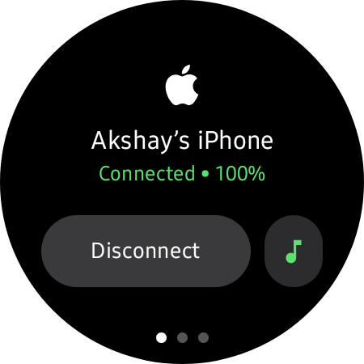
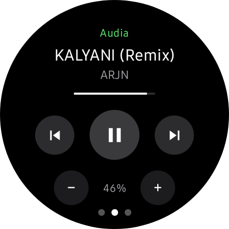

# WearSync — Connect Galaxy Watch & Pixel Watch to iPhone

Use your **Samsung Galaxy Watch**, **Google Pixel Watch**, or **any Wear OS 3.0+ smartwatch with an iPhone** — directly over Bluetooth Low Energy (BLE). **WearSync** mirrors iPhone notifications, incoming calls, live music controls, and iPhone battery status straight to your wrist with **no jailbreak and no iPhone companion app required**.

Powered natively by Apple’s **ANCS** (Apple Notification Center Service), **AMS** (Apple Media Service), and standard **BLE Battery Service**, WearSync turns any modern Wear OS watch into a clean, battery-friendly iPhone companion.

---

## Screenshots

| Active Device & Battery | Mini Music Control | Connect Devices |
| :---: | :---: | :---: |
|  |  |  |

---

## Features

### iPhone Notifications & Incoming Calls on Wear OS
- **No iPhone Companion App Needed:** Connects directly from your Wear OS watch to your iPhone over Bluetooth — nothing to install on iOS.
- **Instant iPhone Alerts on Your Wrist:** Receive WhatsApp, Messages, Phone, FaceTime, Gmail, Instagram, Slack, Discord, and other iOS notifications with recognizable app icons.
- **Dedicated Incoming Call Ringing Screen:** Full-screen incoming call alert with caller name, pulsing indicator, continuous ring vibration, and **Accept / Decline** buttons.
- **Two-Way Notification Dismiss:** Dismissing an alert on your watch clears it on your iPhone as well.
- **Clean Popups & Drawer:** New alerts wake your watch screen with a minimal card while keeping your notification drawer tidy.
- **Shows Your Real iPhone Name:** Displays your actual iPhone name (e.g., *Akshay’s iPhone*) instead of a generic Bluetooth label.

### Minimal iPhone Music Control (Apple Media Service)
- **Control iPhone Audio from Wear OS:** Play, pause, skip to next/previous track, and adjust iPhone volume with rounded `−` / `+` buttons directly from your watch.
- **Live Now Playing Info:** Displays the active player name (Spotify, Apple Music, Audia, Podcasts, etc.), track title, artist, and a hairline progress bar.
- **Adaptive Player Controls:** Supports queue Shuffle/Repeat modes, track Like, and `±15s` podcast/audiobook skip when exposed by the active iOS media app.
- **Quick Home Shortcut:** Tap the music button next to `Disconnect` on the Home screen to jump straight to playback controls.

### Live iPhone Battery & Watch Face Complication
- **iPhone Battery Percentage on Watch:** Reads your iPhone’s live battery level over BLE (`0x180F`) and displays it right on the **Active Device** screen (e.g., `Connected • 100%`).
- **Wear OS Watch Face Complication:** Add the **iPhone Battery** complication (`Ranged Value` or `Short Text`) directly to your favorite Wear OS watch face.

### Simple 3-Screen Watch Interface
1. **Active Device:** Paired iPhone name, live connection & battery status, `Connect` / `Disconnect` / `Forget`, and a one-tap Music shortcut.
2. **Music Control:** Ultra-minimal OLED player for iPhone media and volume.
3. **Connect Devices:** Scans for nearby Apple devices and filters out non-Apple phones.

---

## Compatibility

- **Smartwatches:** Samsung Galaxy Watch (4, 5, 6, 7, Ultra), Google Pixel Watch (1, 2, 3), OnePlus Watch, TicWatch, and any smartwatch running **Wear OS 3.0 or newer** (`minSdk = 30`).
- **Phones:** Any **iPhone** running iOS with **Share System Notifications** enabled in Bluetooth settings.
- **Building from Source (optional):** JDK 17, Android Gradle Plugin `8.7.3`, Kotlin `2.0.21`, Android SDK `35`.

---

## How to Connect Your Wear OS Watch to iPhone

### 1. Install WearSync on Your Watch
Download the signed release APK (`app-release.apk`) from **Releases** and install it over ADB:

```bash
adb install app-release.apk
```

> Upgrading from a debug build? Uninstall it first (`adb uninstall com.wearsync.watch`) before installing the release APK.

### 2. Pair with Your iPhone
1. Open **WearSync** on your watch and allow **Nearby devices** and **Notifications** permissions.
2. Swipe to **Connect Devices** and tap **Scan iPhone** (or select your watch in iPhone **Settings → Bluetooth**).
3. Confirm the Bluetooth pairing code on both your watch and iPhone.
4. **Important:** On your iPhone, open **Settings → Bluetooth**, tap the **(i)** icon next to your watch, and turn **Share System Notifications** **ON**.

### 3. Add the iPhone Battery Watch Face Complication (Optional)
1. Long-press your Wear OS watch face and tap **Customize**.
2. Select a complication slot and choose **WearSync → iPhone Battery**.

---

## FAQ

**Does WearSync require an iPhone app or jailbreak?**  
No. WearSync uses standard Bluetooth Low Energy services built into iOS (**ANCS**, **AMS**, and **Battery Service**), so no iOS app or jailbreak is needed.

**Can I control Spotify or Apple Music on my iPhone from a Galaxy Watch or Pixel Watch?**  
Yes. Once paired, swipe to the **Music** screen in WearSync to play/pause, skip tracks, and adjust iPhone volume.

**Can I answer or decline iPhone calls from my Wear OS watch?**  
Yes. Incoming calls trigger a dedicated full-screen ringing UI with **Accept** and **Decline** buttons synced back to your iPhone via ANCS.
